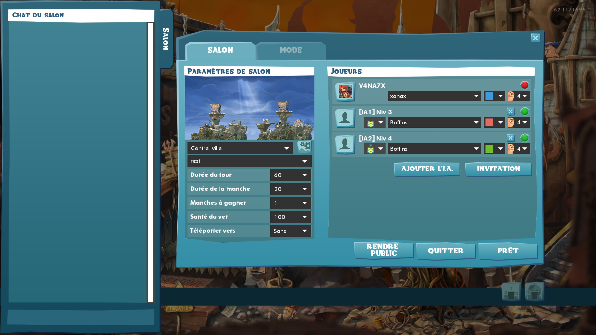

# wmd-online-ai

**Français** · [English](#english)

Mod pour **Worms W.M.D** (Steam) : jouez en ligne avec des équipes IA en plus de vos amis.



## Fonctionnalités

- **IA en ligne** : l'hôte ajoute des équipes IA dans le lobby en ligne, avec les vrais éléments du lobby local du jeu.
  - **Bouton « Ajouter l'I.A. »** : à côté de « Invitation », sur la première ligne libre.
  - **Sélecteur de difficulté** (chevrons) : change le niveau de l'IA, de 1 à 5.
  - **Croix** : retire l'IA.
  - **Clic droit sur une IA** : *Exclure* retire l'IA, *Couper le son* monte son niveau, *Profil* le baisse.
  - Équipe, couleur et nombre de vers se règlent comme pour un joueur.
- **Noms clairs** : chaque IA s'affiche « [IA1] Niv 3 », dans le lobby et en partie, de façon identique chez tous les joueurs.
- **Synchronisation** : l'IA est calculée sur chaque PC (le jeu fonctionne en lockstep), partie et revanche comprises. Elle utilise toutes les armes et outils, jetpack compris.

## Installation

Téléchargez le dépôt (**Code → Download ZIP**), puis copiez `dinput8.dll` **jeu fermé** dans le dossier du jeu (`...\steamapps\common\WormsWMD\`, à côté de `Worms W.M.D.exe`). **Tous les joueurs doivent avoir la même `dinput8.dll`.**

| Fichier | Rôle |
|---|---|
| `dinput8.dll` | le mod : chargé automatiquement par le jeu, il transmet ensuite les appels au vrai `dinput8.dll` de Windows |

Aucun fichier du jeu n'est remplacé ni modifié : ni l'`.exe`, ni sa protection Steam, ni les fichiers de données. Les écrans du lobby sont complétés en mémoire au chargement. Pour désinstaller, supprimez `dinput8.dll`.

Au premier lancement, le mod crée `wmdmod.ini` (réglages avancés) ; il n'est pas nécessaire d'y toucher.

## Utilisation

1. L'hôte crée une partie en ligne.
2. Il clique sur **Ajouter l'I.A.**, autant de fois que voulu, dans la limite des places du lobby.
3. Il règle la difficulté de chaque IA avec les chevrons, et son équipe, sa couleur et ses vers comme d'habitude.
4. Les amis rejoignent et la partie se lance normalement.

## Limites

- **Version Steam** de Worms W.M.D uniquement (`Worms W.M.D.exe` 32 bits). Si le code du jeu ne correspond pas, le mod reste inactif.
- **Seul l'hôte** ajoute, règle ou retire les IA. Chez les invités, les boutons sont visibles mais sans effet.
- Chez les invités, les IA apparaissent comme des joueurs distants : nom « [IA1] Niv 3 », sans sélecteur ni croix.
- Usage entre amis, sans garantie. Tout se fait en mémoire.

## Compilation

Sources dans `src\` — MinGW 32 bits (`src\build.bat`) :

```
gcc -std=gnu99 -O2 -shared -s -DWMD_NOLOG -DWMD_NOBEEP -o dinput8.dll wmdmod.c dinput8.def -Wl,--kill-at,--enable-stdcall-fixup -static-libgcc
```

Sans `-DWMD_NOLOG -DWMD_NOBEEP`, vous obtenez une version de diagnostic : elle écrit `wmdmod_log.txt` à la racine du jeu et émet des bips.

`banner_frag.h` contient les éléments du lobby local ajoutés au lobby en ligne. Il est généré par `mkbanner.py` puis `mkheader.py`, à partir des écrans `WMD_LocalLobby.bkm` et `WMD_OnlineLobby.bkm` du jeu (`wads\uidata_0.wad`).

## Crédits

- **WMD-Mod (IA en ligne)** : jiangwei4
- Worms W.M.D © Team17. Ce projet n'est ni affilié à Team17 ni approuvé par Team17.

---

## English

A mod for **Worms W.M.D** (Steam): play online with AI teams alongside your friends.


### Features

- **Online AI**: the host adds AI teams to the online lobby, using the game's own local-lobby controls.
  - **"Add AI" button**: next to "Invite", on the first empty row.
  - **Difficulty selector** (chevrons): sets the AI level, from 1 to 5.
  - **Cross**: removes the AI.
  - **Right-click an AI**: *Kick* removes it, *Mute* raises its level, *Profile* lowers it.
  - Team, colour and number of worms work just like for a player.
- **Clear names**: each AI shows as "[IA1] Niv 3" (AI 1, level 3), in the lobby and in game, the same for every player.
- **Sync**: the AI runs on every PC (the game uses lockstep), including rematches. It uses every weapon and utility, jetpack included.

### Installation

Download the repository (**Code → Download ZIP**), then copy `dinput8.dll` **with the game closed** into the game folder (`...\steamapps\common\WormsWMD\`, next to `Worms W.M.D.exe`). **Every player must have the same `dinput8.dll`.**

| File | Purpose |
|---|---|
| `dinput8.dll` | the mod: loaded automatically by the game, it then forwards calls to Windows' real `dinput8.dll` |

No game file is replaced or modified: not the `.exe`, not its Steam protection, not the data files. The lobby screens are extended in memory when they load. To uninstall, delete `dinput8.dll`.

On first launch, the mod creates `wmdmod.ini` (advanced settings); you don't need to touch it.

### Usage

1. The host creates an online game.
2. The host clicks **Add AI** as many times as wanted, up to the lobby's free slots.
3. The host sets each AI's difficulty with the chevrons, and its team, colour and worms as usual.
4. Friends join and the game starts as usual.

### Limitations

- **Steam version** of Worms W.M.D only (32-bit `Worms W.M.D.exe`). If the game code doesn't match, the mod stays inactive.
- **Only the host** can add, adjust or remove AI teams. Guests see the buttons, but they do nothing.
- On guests' screens, AI teams appear as remote players: named "[IA1] Niv 3", without selector or cross.
- For playing with friends, no warranty. Everything happens in memory.

### Building

Sources in `src\` — MinGW 32-bit (`src\build.bat`):

```
gcc -std=gnu99 -O2 -shared -s -DWMD_NOLOG -DWMD_NOBEEP -o dinput8.dll wmdmod.c dinput8.def -Wl,--kill-at,--enable-stdcall-fixup -static-libgcc
```

Without `-DWMD_NOLOG -DWMD_NOBEEP`, you get a diagnostic build: it writes `wmdmod_log.txt` to the game root and beeps.

`banner_frag.h` holds the local-lobby controls added to the online lobby. It is generated by `mkbanner.py` then `mkheader.py`, from the game's `WMD_LocalLobby.bkm` and `WMD_OnlineLobby.bkm` screens (`wads\uidata_0.wad`).

### Credits

- **WMD-Mod (online AI)**: jiangwei4
- Worms W.M.D © Team17. This project is not affiliated with or endorsed by Team17.
